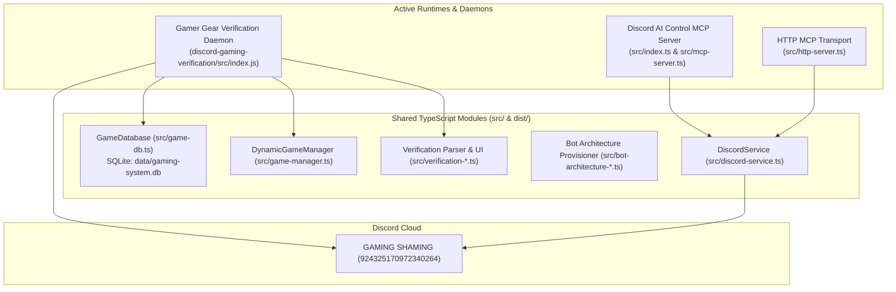

# Project Audit: GAMING SHAMING & Gamer Gear Bot Ecosystem

**Date:** November 3, 2026  
**Target Server:** GAMING SHAMING (`924325170972340264`)  
**Audit Purpose:** Comprehensive Stage 0 technical audit before initiating the Gamer Gear platform evolution roadmap.

---

## 1. Application Architecture

The repository operates as a hybrid TypeScript/Node.js ecosystem combining Discord automation, an MCP (Model Context Protocol) management toolset, dynamic game database services, and an active verification bot runtime.

### Core Architecture Components:
1. **Primary Bot Runtime (`discord-gaming-verification/src/index.js`):**
   - Pure ES module executing under Node.js v24.
   - Connects to Discord Gateway with `Guilds`, `GuildMembers`, `GuildMessages`, `MessageContent`, and partial `Channel`.
   - Orchestrates ephemeral verification, anti-leak filtering, game registration, dynamic channel creation, and moderation alerts.
2. **MCP Service Layer (`src/mcp-server.ts` & `src/index.ts`):**
   - Implements 12 Model Context Protocol tools for AI assistants (Claude, Antigravity, ChatGPT) to audit, inspect, and provision roles, categories, channels, and guild structure.
3. **HTTP Remote Gateway (`src/http-server.ts`):**
   - Express server exposing bearer-token protected endpoints (`/v1/tools`, `/v1/audit`) for remote MCP operations.
4. **Autonomous Agent Integration (`hermes/`):**
   - Hermes configuration bindings and 5 specialized skills (`community-manager`, `permission-auditor`, `server-architect`, `server-maintenance`, `verification-monitor`).

---

## 2. Bot Entry Points and Command Handlers

### Entry Points
- `discord-gaming-verification/src/index.js`: Main long-running bot daemon (`task-857`).
- `src/index.ts`: MCP CLI stdio transport entry point.
- `src/http-server.ts`: MCP HTTP transport entry point (`PORT=3000`).
- `src/provision-cli.ts`: Template-based server provisioner CLI.
- `src/bot-architecture-cli.ts`: Role hierarchy and category/channel overwrite CLI.

### Interaction Handlers (`discord-gaming-verification/src/index.js`)
- **Buttons:**
  - `verify_start_btn`: Initiates or resumes persistent verification session.
  - `verify_check_status_btn`: Reports ephemeral clearance status.
  - `verify_age_adult` / `verify_age_minor` / `verify_age_manual`: Classifies age group without exposing raw numbers.
  - `verify_gender_*`: Gender normalization with one-click Skip button.
  - `verify_confirm_answers`: Commits answers and triggers role assignment.
  - `verify_edit_answers`: Restarts questionnaire while preserving prior valid selections.
  - `game_approve_<id>` / `game_reject_<id>`: Moderator review actions in `#mod-alerts`.
- **Modals:**
  - `verify_age_modal`: Collects numeric age over private ephemeral modal with strict validation (13–100, integers only).
- **Select Menus:**
  - `verify_game_select`: Multi-select game picker.
  - `verify_plat_skill_<slug>`: Dynamic platform and skill picker per selected game.
  - `verify_timing_select`: Available schedule preference.
  - `verify_looking_select`: Matchmaking goals (Casual, Ranked, Squad, Fun).
  - `verify_lang_select`: Primary communication language.
- **Slash Commands Registered:**
  - `/setup-verification`: Posts public Start Verification button card in `#verify`.
  - `/verification-status`: Displays user's verification state.
  - `/review-pending`: Moderation dashboard for pending reviews.
  - `/games list`: Displays catalog by category.
  - `/games request`: Member submits new game for admin review.
  - `/games channel-info`: Shows active dynamic game channels.

---

## 3. Existing Verification Workflow & Security Safeguards

1. **Anti-Leak Filter:** Intercepts messages in `#verify`. Deletes messages matching sensitive age/gender disclosure patterns (`I am 16`, `age: 25`, `gender: male`) and issues ephemeral guidance to use the button. Harmless conversation (e.g. `I play Apex 2`, `need 5 players`) is preserved.
2. **Step-by-Step Ephemeral Flow:**
   - Step 1: Age Classification (18+ Member vs Teen Member 13–17). Reject under-13 immediately.
   - Step 2: Gender Identification (Optional, 1-click skip, normalized).
   - Step 3: Game Selections (from catalog or natural input).
   - Step 4: Platform & Skill Preferences.
   - Step 5: Schedule & Playtime.
   - Step 6: Looking-for preferences & Language.
3. **Explicit Confirmation Gate:** User reviews their summary card. Roles are **never** assigned automatically until the user clicks `Confirm & Complete`.
4. **Role Assignment:**
   - Assigns `Verified Member` (`1566848247065034873`).
   - Assigns age-gate: `Teen Member` (`1566848248386326640`) OR `18+ Member` (`1566848249673977938`).
   - Assigns mapped game and platform roles.
5. **Channel Isolation:**
   - Minor category (`MINOR COMMUNITY`) accessible only by `Teen Member` and `Staff`.
   - Adult category (`ADULT COMMUNITY`) accessible only by `18+ Member` and `Staff`.
   - 0 third-party bots permitted in minor/adult spaces.

---

## 4. Existing Role & Channel IDs

**Guild ID:** `924325170972340264` (`GAMING SHAMING`)  
**Staff / Mod Role:** `1566882252195889172` (`@Moderator` / Staff)  
**Gamer Gear Bot Role:** `1566842295003648074` (Position 49)

### Clearance Roles:
- `Verified Member`: `1566848247065034873`
- `Teen Member`: `1566848248386326640`
- `18+ Member`: `1566848249673977938`

### Categories & Designated Channels:
1. **`INFORMATION` (`1566922313784365109`):**
   - `#welcome`: `924522763396468736` (Ayako)
   - `#rules`: `924522829490323516` (Gamer Gear)
   - `#announcements`: `924523214544199691` (Gamer Gear, Apollo)
   - `#server-updates`: `1566922318049968148` (Xenon, Gamer Gear)
   - `#choose-roles`: `1566898712519901224` (Zira)
2. **`COMMUNITY` (`924325170972340265`):**
   - `#general-chat`: `924325170972340266` (Dank Memer, MEE6)
   - `#introductions`: `1566854081044025457` (Gamer Gear)
   - `#level-ups`: `924522879859716097` (Arcane)
   - `#memes`: `1566908457825607760` (Dank Memer)
   - `#suggestions`: `1566922325373358172` (Sapphire)
3. **`GAMING` (`1566922332730302564`):**
   - `#looking-for-group`: `1566922335196418189` (ezLFG, Gamer Gear)
   - `#gaming-events`: `1566922337666994196` (Apollo)
   - `#game-news`: `1566922340212932649` (SteamDB)
   - `#game-requests`: `1566922342721130638` (Gamer Gear)
   - `#game-bots`: `1566922345229320293` (Falcon, Vetox)
4. **`VOICE` (`1566922349981466765`):**
   - `🔊 Gaming Lounge`: `1566922352355442750`
   - `🔊 Competitive`: `1566922354716704879`
   - `🔊 Casual Gaming`: `1566922357065633853`
   - `🔊 Music Room`: `924522927230181396` (Jockie Music)
5. **`BOT COMMANDS` (`1566922361716867132`):**
   - `#bot-commands`: `1566922364023738368` (Dank Memer, MEE6, Arcane, Sapphire, Zira)
   - `#music-commands`: `924520336719003668` (Jockie Music)
   - `#lfg-commands`: `1566922366817144893` (ezLFG)
6. **`STAFF & LOGS` (`1566922371099664575`):**
   - `#mod-logs`: `1566922373406523413` (Wick, Gamer Gear)
   - `#member-logs`: `1566922375839219803` (Lurkr, Gamer Gear)
   - `#bot-logs`: `1566922378401808466`
   - `#mod-alerts`: `1566854117563826227` (Wick, Sapphire, Gamer Gear)
   - `#ticket-support`: `1566922380847087677`

---

## 5. Database & Persistence Layer

- **Engine:** Built-in Node.js v24 SQLite engine (`node:sqlite`, `DatabaseSync`). Zero external native C++ compilation dependencies (node-gyp / better-sqlite3 not required).
- **File Location:** `data/gaming-system.db` (and fallback in `discord-gaming-verification/data/gaming-system.db`).
- **Schema Management:** Automated via `schema_versions` table with programmatic `migrate()` and `rollback()` support.
- **Active Tables (9 total):**
  1. `game_categories`: 6 categories.
  2. `games`: 92 catalogued games with role colors and channel linkages.
  3. `member_game_profiles`: User-to-game mappings (user_id, game_slug, platform, skill).
  4. `game_requests`: User game requests and moderator disposition.
  5. `audit_logs`: Timestamped administrative actions.
  6. `member_screening_events`: Discord gateway join/screening state transitions.
  7. `schema_versions`: Schema migration history.
  8. `verification_sessions`: Active and completed verification state machine data with JSON payload storage.
  9. `sqlite_sequence`: Autoincrement tracking.

---

## 6. Game Catalog State

- **Total Seeded Games:** 92 games across 6 categories.
- **Seeding Source:** `templates/games-directory.json`.
- **Dynamic Category Allocation:** Max 20–25 channels per category with voice channels created on demand when player thresholds are met.
- **Role Integration:** 24 native onboarding roles mapped to existing guild roles with strict hierarchy checks.

---

## 7. Embed & Card Generation State

- **Current Implementation:** Pure text and rich Discord Embeds constructed via `@discordjs/builders` and `EmbedBuilder`.
- **Limitations:**
  - No canvas, SVG, or graphical card rendering engine installed.
  - Visual output relies on Discord standard embed layouts (fields, thumbnails, footers, colors).
  - No custom banner, profile card image, or animated WebP/GIF asset pipeline exists yet.
- **Stage 1 Opportunity:** Implement an ultra-fast, lightweight image generation pipeline (e.g. `@napi-rs/canvas` or SVG-to-PNG renderer) that produces high-end cinematic esports cards matching the visual design tokens without exceeding Discord's 8MB/10MB attachment boundaries.

---

## 8. Dependencies & Test Coverage

### Root `package.json`:
- `dependencies`: `@modelcontextprotocol/sdk` (^1.6.1), `discord.js` (^14.17.3), `dotenv` (^16.4.7), `express` (^4.21.2), `zod` (^3.24.2).
- `devDependencies`: `@types/express` (^5.0.0), `@types/node` (^22.13.1), `typescript` (^5.7.3).

### Test Suite:
- **Runner:** Node.js native test runner (`node --test dist/**/*.test.js`).
- **Current Passing Tests:** 64 / 64 passing tests across 10 test suites covering:
  - Bot architecture & hierarchy checks.
  - Game database operations & seeding.
  - Hermes skills & authorization filters.
  - Native onboarding role mapping rules.
  - Verification parser & natural-language schedule/game parsing.
  - Ephemeral verification UI & multi-session isolation.
  - Minor vs Adult channel access isolation (positive and negative leak tests).
  - Zira button role panel configurations.
  - Provisioner preflight validations.

---

## 9. Third-Party Integrations Summary

- **24 Bots Audited:**
  - `Gamer Gear`: Central verification, clearance authority, dynamic games.
  - `Zira`: Button roles for self-assignable preference roles.
  - `Ayako`: Exclusive welcome card sender in `#welcome`.
  - `Arcane`: Exclusive XP leveling in `#level-ups`.
  - `Dank Memer`: Fun commands in `#memes` and `#bot-commands`.
  - `Sapphire`: Community suggestions in `#suggestions`.
  - `Apollo`: Server tournament & event calendar in `#gaming-events`.
  - `ezLFG`: LFG matchmaking in `#looking-for-group` and `#lfg-commands`.
  - `SteamDB`: Read-only deal and release announcements in `#game-news`.
  - `Wick`: Security and anti-raid alerts in `#mod-alerts` and `#mod-logs`.
  - `Lurkr`: Join/leave analytics in `#member-logs`.
  - `Jockie Music`: Music in `🔊 Music Room` and `#music-commands`.
- **Administrator Status:**
  - De-escalated: `Xenon`, `Sapphire`, `Vetox`, `Modora`.
  - Pending Manual Owner Action (higher than Gamer Gear role in Discord): `Invite+`, `Wick`, `APAR`, `Falcon™`.

